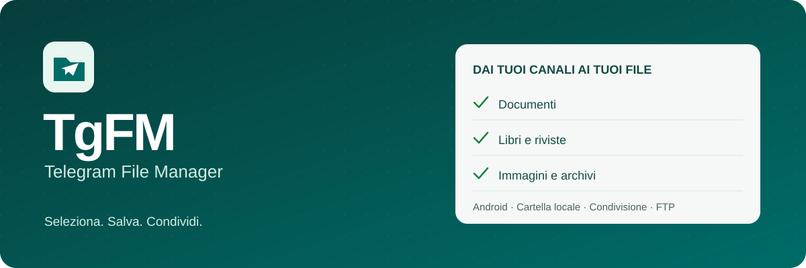

[English](README.md) | [Italiano](README_IT.md)

Vibe Coding! Codex developed this code under the supervision of TheyKilledKenny.

# TgFM - Telegram File Manager



**Your Telegram files, organized your way.**

TgFM is a native Android app for browsing attachments in your Telegram channels and groups, selecting them using configurable rules, saving them to a folder of your choice, sharing them, or sending them to an FTP/FTPS server.

The app uses your personal Telegram account through **TDLib** and runs independently on your phone, without a computer or application server. TgFM follows your Android language preferences, supports English and Italian, and falls back to English. To override the system choice, open **Settings → App language** and select **English** or **Italiano**. Choose **System default** to follow Android again.

**[Download TgFM 1.5.8 for Android (test APK)](https://raw.githubusercontent.com/TheyKilledKenny/TgFM/refs/heads/develop-apk/TgFM-1.5.8-debug.apk)** · [SHA-256](https://raw.githubusercontent.com/TheyKilledKenny/TgFM/refs/heads/develop-apk/TgFM-1.5.8-debug.apk.sha256) · [Installation](#installation-and-first-sign-in)

Android 8.0 or later · ARM64

## Contents

- [Features](#features)
- [Requirements](#requirements)
- [Installation and first sign-in](#installation-and-first-sign-in)
- [Usage](#usage)
- [Favorite channels and groups](#favorite-channels-and-groups)
- [Configuring filters](#configuring-filters)
- [Downloads and file management](#downloads-and-file-management)
- [Sharing and saving](#sharing-and-saving)
- [Current limitations](#current-limitations)
- [Local data and security](#local-data-and-security)
- [Building from source](#building-from-source)
- [Architecture](#architecture)
- [TDLib integration](#tdlib-integration)
- [Third-party licenses](#third-party-licenses)
- [Filter groups and covers](#compact-filter-groups-and-covers)
- [Archive contents](#archive-contents)
- [Release notes](#release-notes)

## Features

- Telegram sign-in using a phone number, code, and two-step verification when required.
- Local session storage and voluntary sign-out.
- Selection of multiple favorite channels and groups, including private or archived ones, with search by name and quick switching of the active channel, without a total limit of 100 items.
- Paginated reading of attachment metadata without downloading the contents first; partial results remain available after cancellation.
- Read posts from today, the last 7 days, a specific day, a date range or the entire channel. Each favorite can have its own default period.
- Recognition of downloadable documents, images, videos, audio, animations, and stickers.
- Persistent rules assigned to a favorite channel, for names, variable dates, extensions, MIME types, and Telegram categories.
- Suggestions for common rules from multiple desired and undesired examples, with preview and confirmation.
- Manual selection of attachments before downloading.
- Up to **four parallel downloads**, individual progress, cancellation, and retry of failed downloads.
- Choice of deleting or keeping previous downloads.
- Sharing through Android Sharesheet, including to WhatsApp.
- Configurable external working folder (default `Download/TgFM`), with a separate TDLib cache inside it.
- FTP/FTPS upload even while Telegram is still downloading, without a second complete copy.
- **Keep after upload** option, individual or multiple deletion, and explicit cache cleanup.

## Requirements

### Device

| Requirement | Value |
|---|---|
| Minimum operating system | Android 8.0 / API 26 |
| Included architecture | ARM64 (`arm64-v8a`) |
| Telegram | Existing personal account |
| Connection | Required for sign-in, reading channels, and downloads |

The project includes only the ARM64 native library. For an x86/x86_64 emulator or a device with another ABI, you must build and add the corresponding TDLib library.

## Installation and first sign-in

1. Download the 1.5.8 test APK using the link at the top of this page in your phone’s browser. Open the `.apk` file from your downloads and choose **Install**. If Android asks, allow **Install unknown apps** for the browser or file manager you used. A computer, ADB, and USB debugging are not needed. To update an installed copy with the same signature, open the new APK without uninstalling the app or deleting its data.
2. Open **Settings**, grant file access, and choose the folder under **Files and folder**. Under **Telegram**, enter your **API ID** and **API hash**, obtained from [my.telegram.org](https://my.telegram.org) under *API development tools*. These are Telegram app credentials, not a Bot API token. You do not need to rebuild the APK.
3. Tap **Set up access**, then enter your number with its international prefix, the received code, and your two-step verification password if required. The app also handles email steps requested by TDLib. Set up access starts a new session, deleting the previous Telegram database; you do not need to tap it on every launch after a successful login.
4. Under **Settings → Favorite channels**, tap **Refresh channels and groups**, search by name, and check the ones to add to favorites. For an invite-only channel, first join it using the official Telegram app.

On Android 11 or later, access to the external folder requires **All files access**, available under special access in Android settings. On Android 8–10, storage permission is requested.

New account registration and any purchase steps required by Telegram must be completed in the official app. The session is reused on subsequent launches as long as it remains valid.

## Usage

The menu follows this order:

| Area | Main actions |
|---|---|
| **Selection** | Switch between favorite channels by tapping the name, read and search attachments, and choose Save, Share, or Save to FTP |
| **Downloads** | Monitor transfers, open completed files, select, share, send to FTP, or delete |
| **Filters** | Assign rules to favorites, edit them using icon actions, and configure them from searchable examples |
| **Settings** | Manage sign-in, favorite channels, working folder, cache, FTP, and download policy |

On startup, the app opens Selection when the session and favorite channel are ready; otherwise it opens Settings. A temporary Telegram reconnection, including after returning from the background, does not block Selection: previously read metadata can be viewed while the connection is restored. An invalid session or lack of an active channel requires Settings. Downloads and Filters remain manually accessible for local functions.

Typical workflow:

1. In **Selection**, tap the channel name or picture to choose a favorite. Check the period under **Post** and tap **Read**. Searching by filename preserves the selection of hidden files.
2. Check the results, choosing **Show → Selected only**, **Selected and similar**, or **All files**. Selected items are always at the top, including those selected manually. Similar files are possible matches. The chosen view is retained.
3. Adjust the checkboxes and tap **Save**, **Share**, or **Save to FTP**.
4. Downloads shows the complete files in the working folder: they can be shared, sent to FTP, opened, or deleted.

**Select all** and **Deselect all** affect all selectable attachments read from the channel, even when search and the view hide some of them. In Downloads they affect the entire local list. The Save, Share, and Save to FTP buttons use the entire selection, not just the visible rows.

### Post date range and cancelling a read

The **Post** selector concerns the Telegram message date, independently of any dates in the filename:

| Option | Posts read |
|---|---|
| **Today** | From the first instant of the current day to the following midnight |
| **Last 7 days** | Today and the six preceding days |
| **All files** | Entire accessible history |
| **Specific day** | All posts on the date chosen in the calendar |
| **Date range** | From midnight at the start to the end of the last chosen day, including both days |

The phone's time zone is used, including daylight saving time changes. Today is recalculated when Read is pressed. Opening a channel applies the default period from its profile. Changing it does not alter attachments already displayed: press Read again to read the new period. The calendar allows dates from 1970 to 2037, compatible with TDLib timestamps; a reversed range disables reading and shows an error.

For bounded periods, TgFM uses `getChatMessageByDate` to reach the last post within the end date, then reads backwards and stops at the first post before the start date. It does not traverse the entire history and filter it afterwards. The scan reads attachment metadata. Visible photos may load small previews.

Results are published as each page arrives and the active channel's rules are applied. **Cancel operation** stops subsequent requests while retaining names, references, and automatic selections already collected: **Partial scan** distinguishes the result from a completed read. Results remain available for selection and download. A new read replaces the list; switching channels clears it. Scan results are held in memory.

## Compact filter groups and covers

In **Filters**, tap a channel heading to collapse or expand its rules. The rule count and enabled count remain visible. **Collapse all / Expand all** controls all groups; collapsing a group does not disable its filters. The open/closed state survives screen changes and activity recreation.

In **Settings → Favorite channels**, open the settings icon beside a favorite and enable **Photo covers**. A photo in the immediately preceding message is associated with the next document, audio or video file. For a multipart archive, the photo preceding its first published part is used. An intervening text or other message breaks the association; web previews and stickers are not used.

Tap the left column to select the file. Its cover shows the selection indicator. Files without covers use a standard checkbox in the same column. Tap the rest of the row for the preview and captions. In cover mode, photos used as covers are hidden from the list and excluded from automatic selection and Select all. Switching cover mode off shows them again immediately. Image details show the saved image or an available Telegram thumbnail, including for images posted as documents. This also works with photo covers turned off.

## Favorite channels and groups

Refreshing enumerates all TDLib pages of the main and archived lists and includes channels, supergroups, and basic groups; private chats are excluded. The value 100 is the size of a loading page, not the maximum number of favorites or results. The complete list is sorted by name and duplicates are removed.

In **Settings → Favorite channels**, tap the channel picture to add or remove a favorite. A check mark identifies a favorite. Channels without a picture show their initial. In **Selection**, tap the name or picture to switch channels. Tap **Read** to load the new channel’s attachments with its filters.

Each new or edited rule must be assigned to a favorite in the editor. Suggestions from examples are assigned to the channel from which the attachments were read. Identical rules on different channels remain separate.

Removing a favorite also deletes the filters associated with that channel. If there are filters, a single confirmation shows their number; cancelling it changes nothing. With no associated filters, removal is immediate. Already downloaded files are not deleted. If the active channel is removed, the first remaining favorite is selected; if there are no favorites, Settings opens.

The settings icon beside each favorite opens its profile. **Photo covers** is off by default. Enable it to use the photo posted immediately before an attachment. **Default period** offers Today, Last 7 days or All files. Under **Archive sharing**, choose the general setting, the original archive or its contents. You can override this choice when confirming an individual transfer.

## Configuring filters

### The pattern concerns the name, not the format

The pattern is matched against the entire name **without the extension**. The root field does not automatically add `.pdf` or other extensions.

For example, create two separate inclusion rules:

```text
La_Gente_{data}
Il_Pino_Verde_{data}
```

With **Extensions** empty, these rules allow PDF, EPUB, TXT, and other formats:

| Name | Automatically selected |
|---|---|
| `La_Gente_14_Novembre_2026.pdf` | Yes |
| `La_Gente_15_Novembre_2026.epub` | Yes |
| `Il_Pino_Verde_14_Novembre_2026.txt` | Yes |
| `La_Gente_Roma_14_Novembre_2026.pdf` | No |
| `D_La_Gente_14_Novembre_2026.pdf` | No |
| `Il_Pino_Verde_apostolico_14_Novembre_2026.pdf` | No |
| `Estratto_Il_Pino_Verde.pdf` | No |

In the **Exact prefix before date** field, enter, for example, `La_Repubblica_`, including the trailing separator. The generated pattern will be `La_Repubblica_{data}`.

`{data}` recognizes, among others, `14Nov`, `14Nov2026`, `14_Novembre_2026`, `14 Novembre 2026`, `2026-11-14`, `14.11.2026`, and `20261114`. Recognition is syntactic: it does not check whether the day is valid in the calendar. It does not accept additional segments in place of the date.

### Type criteria and combinations

| Criterion | Example | If left empty / set to Qualsiasi (Any) |
|---|---|---|
| Extensions | `pdf` or `pdf, epub` | All formats |
| MIME | `application/pdf` or `image/*` | No MIME restriction |
| Telegram category | Document, Image, Video, Audio, Sticker | No category restriction |

The **Document** category can include PDFs, EPUBs, and archives: it is not synonymous with PDF.

- Criteria filled in within the same rule are combined with **AND**.
- Multiple inclusion rules are combined with **OR**.
- Explicit exclusions take precedence over inclusions.
- Disabled rules or rules without criteria select nothing.
- Comparisons are case-insensitive.

### Classification and manual selection

- **Exact match**: matches an inclusion and no exclusion; initially selected.
- **Possible match**: resembles a rule but does not fully match it; not initially selected.
- **No match**: does not match the rules; not selected.
- **Excluded**: matches an explicit exclusion; not selected.

An unwanted variant may appear as Possible without being downloaded automatically. You can manually select even an excluded item: the choice applies only to the current operation and does not change the filters. Confirming a rule change recalculates automatic selections.

### Configure from examples

1. After reading a channel, open **Filters → From examples** and search for the desired names.
2. Mark multiple files as **Wanted** or **Unwanted**. Labels remain assigned even when the search hides the files; **Marked examples only** is available.
3. Tap **Suggest common rules**.
4. Check patterns, counts, the preview, and warnings, then confirm. The preview lists only files that would be automatically selected, without Possible, Not matching, or Excluded items.

Dates are generalized while preserving the complete root. Fifty issues of the same publication can produce a single rule instead of fifty exact names. With positive examples, negative examples constrain the suggestions without generating a blacklist for each variant. Ambiguous suggestions are flagged and omitted. With only negative examples, grouped exclusions may be suggested.

Generation from examples looks for families of names with variable dates: **it does not automatically infer a rule for an extension**, such as “all PDFs”. Different names can produce multiple rules; names without a recognized date are flagged without a suggested rule. To choose a format, use a manual rule as described below. Arbitrary regular expressions are not exposed. The preview also considers saved active rules: a broad inclusion such as “contains La_Gente” may continue to include local editions until it is modified or disabled.

### Select only PDFs

Under **Filters → New rule**:

1. Choose the favorite channel and give the rule a name, for example **PDF only**.
2. Leave the action as **Inclusion**.
3. Leave **Exact prefix before date** and **Filename pattern without extension** empty.
4. Open **More criteria · format and contents** and set **Extensions** to `pdf`. Leave contained text and MIME empty and keep the category on **Any**.
5. Confirm saving.

The rule selects PDFs regardless of name and date. An exclusion rule for every other format is unnecessary: files that do not match any inclusion remain unselected. To get *only* PDFs in the channel, disable any other inclusions that select different formats; existing active exclusions may still exclude some PDFs. Manual selection remains available.

## Downloads and file management

The working folder is outside the app's private storage. The default path is `Download/TgFM`; **Settings → Files and folder → Choose folder** lets you choose another local folder, including one on an accessible removable volume. Cloud folders are not supported as a direct TDLib destination. Android 11 and later require **All files access**, because TDLib must access the real path; document picker permission alone is not enough. Android 8–10 requires permission to write to shared storage.

Complete files reside in the chosen folder. TDLib writes to `.tgfm-cache/tdlib` inside it; when saved, the complete file is renamed on the same filesystem, without a second complete copy. The filesystem must allow this operation and files of the required size: FAT32, for example, does not support files of 4 GiB or more. No fallback to private storage or an additional full copy is performed.

Filters and files in the external folder are separate from the Telegram session. Setting up new access does not recover a previous session.

Changing folders closes and reopens TDLib without moving or deleting files in the previous external folder. The cache can be explicitly deleted with **Clear temporary cache** when transfers are stopped; this does not delete final files.

Under **Settings → Files and folder**, **Clear previous downloads** applies to Save and Share from Selection:

| Setting | Behavior |
|---|---|
| Disabled - default | Reuses an already saved and recognized attachment; keeps other files and replaces other files with the same name when the download starts |
| Enabled | First deletes files managed by TgFM in the current folder; other files and subfolders are not cleared |

FTP does not apply this general cleanup. Overwriting files with the same name is destructive: an error can cause the previous file to be lost. No backups are kept. Names are sanitized; files with the same name in the same batch receive distinct names. A maximum of four downloads can proceed simultaneously, coordinating attachments with the same TDLib file ID.

## Sharing and saving

**Save** on the Selection page downloads files directly to the working folder. **Share** first performs the same save (reusing files already available), then opens Android sharing. If some saves fail, sharing does not start automatically: you can retry or share completed files from the Downloads page.

Sharing uses `ACTION_SEND`/`ACTION_SEND_MULTIPLE`, `content://` URIs, and temporary read-only permissions. Receiving apps can read selected files or individual entries streamed from a saved archive. It creates neither a staging folder nor an additional copy; the receiving app may make its own copies and impose limits on size, number, and format. Returning to TgFM does not confirm delivery to the recipient.

In Downloads, **Share**, **Save to FTP**, the eye icon to open a file, and trash icons to delete a file or the selection are available. Local deletions do not change Telegram or the FTP server.

### Save to FTP

Under **Settings → FTP server**, configure the host, port, user, password, and an existing remote folder. Save changes before using **Check access**. Passive mode is used, with binary FTP or **Explicit FTPS (TLS)**. FTPS verifies the certificate chain and name; it does not automatically accept untrusted certificates. Plain FTP does not encrypt credentials or content. The check verifies login and folder access; it does not create remote files to test write access.

The confirmation for each upload lets you change **Keep on device** for that operation only, starting from the saved preference. The dialog shows the destination and accepts a relative subfolder, such as `copies/november`, created if permitted by the server. The configured base folder remains unchanged.

| Keep after upload | Behavior |
|---|---|
| Off - default | One file at a time. After FTP confirmation the local copy is deleted, even if it came from Downloads |
| On | The file remains in the working folder; up to four simultaneous transfers |

The early-upload behavior below applies to ordinary files without a per-upload subfolder. Archives are downloaded completely before their contents are read; archive groups are processed one at a time, with parallel downloads of their volumes. No extracted disk copy is created.

From Download, existing files are uploaded. From Selection, an already saved attachment is reused when available; otherwise the TDLib download starts and the upload can begin before it finishes. A single FTP `STOR` stream reads only contiguous bytes confirmed by `getFileDownloadedPrefixSize`, waiting when they are not yet available. The apparent size of the partial file is not used as an indication of downloaded bytes. The read/send buffer is 256 KiB; entire files are not loaded into RAM.

The download remains **complete on the device**: early upload can overlap receiving and sending, but does not reduce the space needed for the complete file. With Keep enabled, space is needed for all new selected files. Reported available space and a 16 MiB margin are checked; other processes may still consume space during the operation.

The local copy is deleted only after a positive final response from the server and a size check, if the server supports `SIZE`. Writing the bytes to the socket is not enough. There is no universal remote hash verification. An error or cancellation keeps the complete file or the partial file in the cache; with Keep disabled, the queue stops at the first error to avoid accumulating more files. The cache is cleared manually from Settings. There are no automatic resumes, recoveries, or migrations on restart.

Files with the same name on the server are overwritten directly. An error may leave an incomplete remote file and lose the previous file with the same name; no backups or temporary remote names are introduced. Speed depends on Telegram, the server, and the network; overlapping upload does not guarantee a speedup on every connection.

## Archive contents

Multipart archives appear as one item in Selection and are grouped before filename filters. **Save** keeps the original archive and its volumes. **Share** and **Save to FTP** can use either the originals or all files inside, without writing extracted copies to the device. In Downloads, if the selected archives come from channels with different settings, the dialog offers the general setting.

Keep the archive available while receiving apps read shared contents. **Keep on device** keeps the original archive after an FTP upload; otherwise the local volumes are deleted only after the entire archive's upload succeeds. The FTP confirmation also accepts a relative destination such as `copies/november`, without changing the saved configuration. Remote cleanup after a failed archive transfer requires confirmation.

Supported naming conventions include `.partN.rar`, `.rar/.rNN`, `.zNN/.zip`, `.7z.NNN` and `.zip.NNN`. Encrypted or unsupported archives can still be sent as originals. Actual format support depends on the bundled decoders.

## Current limitations

- One Telegram account and one active channel at a time, chosen from multiple favorites. Simultaneous scanning of multiple channels is not available.
- Generation from examples generalizes dates in names but does not recognize format as a common criterion. A manual extension rule is available to select all PDFs.
- Even with early FTP upload, the device needs space for the entire file.
- Accessible local folders are supported, not cloud destinations for the TDLib cache.
- The distribution includes ARM64 only; it is not available in an app store.

## Local data and security

- API ID/hash, database key, and FTP configuration are encrypted with AES-GCM and Android Keystore.
- The TDLib session database is encrypted and remains private; login codes and 2FA passwords are not saved by the app.
- Channels, rules, and preferences remain in private storage.
- Saved attachments and the TDLib cache are in the external folder, so they are also accessible through an authorized file manager.
- Sharing grants read-only access to chosen files and does not expose the database or cache.
- Android backup and automatic data transfer are disabled.
- A foreground service accompanies user-initiated transfers. Normal Activity recreation retains state; process termination does not automatically restart operations.

## Building from source

### Build environment

| Component | Configured version |
|---|---|
| Java | JDK 21 recommended; JVM 17 bytecode |
| Gradle | 8.13, provided by the Wrapper |
| Android Gradle Plugin | 8.13.2 |
| Kotlin / Compose plugin | 2.2.21 |
| Android compile SDK | API 36 |
| Android target SDK | API 35 |
| Android Build Tools | 35.0.0 |
| Android NDK | 27.2.12479018 |
| Compose BOM | 2025.11.00 |

The prebuilt TDLib library is included: **a normal app build does not require building TDLib or installing CMake**. The configured NDK is used by the Android tools to process native libraries. Gradle dependencies are downloaded from Google Maven, Maven Central, and the Gradle Plugin Portal.

### 1. Clone the repository

```bash
git clone --branch develop https://github.com/TheyKilledKenny/TgFM.git
cd TgFM
```

### 2. Set up the Android SDK and Java

In Android Studio, install the components listed in the table above using SDK Manager. Alternatively, with the Android SDK Command-line Tools available:

```bash
sdkmanager "platforms;android-36" "build-tools;35.0.0" "platform-tools" "ndk;27.2.12479018"
sdkmanager --licenses
```

Set `JAVA_HOME` to the JDK and `ANDROID_HOME` to the SDK directory. Alternatively, instead of `ANDROID_HOME`, create a local `local.properties` file in the project root:

```properties
sdk.dir=/absolute/path/to/Android/Sdk
```

`local.properties` must not be added to the repository.

### 3. Generate the release APK

To build the test APK, run `./gradlew :app:assembleDebug`. The output is `app/build/outputs/apk/debug/app-debug.apk`. To build a signed **release** APK, follow the steps below.

For a signed build, set these environment variables:

| Variable | Value |
|---|---|
| `TGFM_KEYSTORE` | Absolute path to the keystore |
| `TGFM_STORE_PASSWORD` | Keystore password |
| `TGFM_KEY_ALIAS` | Signing key alias |
| `TGFM_KEY_PASSWORD` | Key password |

Use your own secret manager or a local configuration excluded from Git. Do not put passwords in project files or command history.

On Linux/macOS:

```bash
./gradlew :app:assembleRelease
```

On Windows, from PowerShell:

```powershell
.\gradlew.bat :app:assembleRelease
```

With all variables configured, `app/build/outputs/apk/release/app-release.apk` is produced. Without the variables, `app-release-unsigned.apk` is produced and requires signing before installation. A partial signing configuration stops the build with an explicit message; a debug key is not used automatically.

Official APKs are attached to [GitHub Releases](https://github.com/TheyKilledKenny/TgFM/releases). The `develop-apk` branch contains development APKs. To update an already installed app while keeping its data, the same application ID, a compatible signature, and an appropriate version code are required.

## Architecture

```text
app/src/main/
├── java/it/tgfm/
│   ├── core/         Models, filters, names, navigation, and parallelism
│   ├── data/         DataStore, Keystore, external folder, FTP, and sharing
│   ├── telegram/     TDLib JSON client and metadata conversion
│   ├── ui/           Compose interface and ViewModel
│   ├── MainActivity.kt
│   ├── TgfmApp.kt
│   └── TransferService.kt
├── java/org/drinkless/tdlib/JsonClient.java
├── jniLibs/arm64-v8a/libtdjsonjava.so
├── res/
└── AndroidManifest.xml
```

The source branches contain the Android project, README, cover, and license notices. APKs, caches, and local development tools are separate; release APKs are attached to GitHub Releases and development builds are in the `develop-apk` branch.

## TDLib integration

The integration uses the official **JSONJava** interface, not the Bot API.

| Component | Source |
|---|---|
| TDLib | 1.8.70, commit `c8828d50f5eac2fc7089ce1089d7ce9095c61b5e` |
| Java binding | `JsonClient.java` from the same TDLib revision |
| Included binary | `app/src/main/jniLibs/arm64-v8a/libtdjsonjava.so` |
| OpenSSL | 3.5.4, statically linked |
| C++ runtime | Static, Android NDK 27.2.12479018 |
| ELF alignment | 16 KiB |

SHA-256 of the included TDLib binary:

```text
511c1d6505de65136876f3ca6d9ca0e0ac27995914fcd44788ea02848cc72102
```

To rebuild the native component or add other ABIs, follow the [upstream Android instructions for the revision used](https://github.com/tdlib/td/tree/c8828d50f5eac2fc7089ce1089d7ce9095c61b5e/example/android), choosing the `JSONJava` interface. Copy the resulting libraries to `app/src/main/jniLibs/<ABI>/` and update `abiFilters` in the Gradle configuration. The binding and library must come from the same revision.

## Third-party licenses

- **TDLib:** [Boost Software License 1.0](docs/licenses/TDLib-Boost-1.0.txt).
- **OpenSSL:** [Apache License 2.0](docs/licenses/OpenSSL-Apache-2.0.txt).
- **SQLite/SQLCipher included in TDLib:** [ZETETIC LLC BSD notice](docs/licenses/SQLite.txt).
- **libarchive-android 1.1.6:** [Apache 2.0 wrapper](docs/licenses/libarchive-android-Apache-2.0.txt), [libarchive notices](docs/licenses/libarchive.txt).
- **Zip4j 2.11.5:** [Apache 2.0](docs/licenses/Zip4j-Apache-2.0.txt).
- **Apache Commons Net 3.12.0:** [Apache License 2.0 and notice](docs/licenses/Commons-Net.txt).
- **AndroidX, Jetpack Compose, Kotlin, and coroutines:** respective upstream licenses and notices; dependencies are declared in the Gradle configuration.

The names Telegram and WhatsApp identify third-party services. TgFM is an independent project.

## Release notes

### 1.5.8 - Favorite channel settings

Each channel has a profile under **Settings → Favorite channels**. For a magazine channel, for example, turn on **Photo covers** to display the preceding post’s photo beside the file. For an infrequently updated group, choose **Last 7 days** as its default period. You can also choose whether to share original archives from that channel or send their contents.

Profile pictures help you identify channels. Tap a picture to mark a favorite. In Selection, open an image file’s details to see a preview, even when photo covers are turned off.

### 1.5.7 - App language

English and Italian are available for navigation, dialogs, accessibility labels and transfer messages. On Android 13 and later, you can also change the language in Android’s per-app language settings.

### 1.5.6 - Cover selection

In channels with covers enabled, tap the image to select the file or tap the rest of the row for details. **Select all** skips photos used as covers, so you can save the document without saving its cover as a separate file.

### 1.5.5 - Channel rule groups and photo covers

In Filters, collapse one channel’s rules to find another channel’s rules more easily. When a channel posts a photo immediately before an attachment, you can display that photo as its cover and read the caption in the file details.

### 1.5.4 - Archive sharing and FTP

Volumes of an archive split across posts appear as one item. Share or upload the original volumes, or send the files inside without saving a second, extracted copy on your phone. Each FTP upload can use its own subfolder. If an archive upload fails, TgFM asks before attempting to remove affected files from the server.

### 1.5.3 - First stable release

Selection and Downloads keep their action buttons above the navigation bar, so you can act on a selection without scrolling back through the list. Tap an attachment for its full details. In Filters, rules are grouped by channel and the preview shows which files your example-based rules would select. When sending files to FTP, you can choose whether to keep the local copies for that upload.

### 1.5.2 - Telegram access

Fixed a startup issue that could prevent Telegram sign-in even with valid credentials. If sign-in fails, the error stays visible on the Telegram screen.

### 1.5.1 - File access

When Android requires file access to be granted in system settings, TgFM checks the permission again when you return so you can continue setting up the folder.

### 1.5.0 - External folder and FTP

Choose a folder on your device for downloads, share saved files and upload them to an FTP or FTPS server. Some uploads can start while Telegram is still downloading. **Keep after upload** keeps the local copy after a successful transfer. In Downloads you can delete one file or several selected files.
