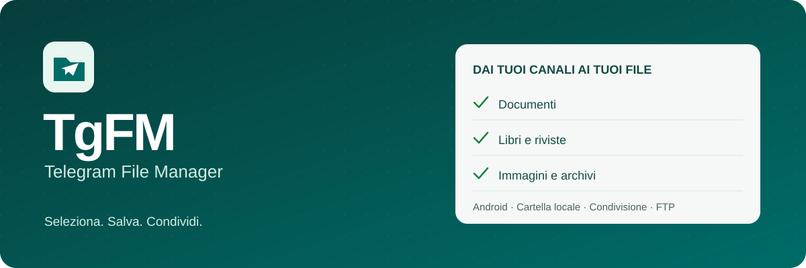

[English](README.md) | [Italiano](README_IT.md)

Vibe Coding! Questo codice è stato sviluppato da Codex, con la supervisione di TheyKilledKenny.

# TgFM - Telegram File Manager



**I tuoi file Telegram, organizzati a modo tuo.**

TgFM è un'app Android nativa per consultare gli allegati dei propri canali e gruppi Telegram, selezionarli attraverso regole configurabili, salvarli nella cartella scelta, condividerli o inviarli a un server FTP/FTPS.

L'app utilizza l'account Telegram personale tramite **TDLib** e funziona autonomamente sul telefono, senza un computer o un server applicativo. Nella build di sviluppo TgFM segue le lingue preferite di Android. Supporta italiano e inglese e usa l’inglese se nessuna lingua preferita è supportata. In **Configura → Lingua dell’app** puoi scegliere **Italiano**, **English** oppure tornare a **Lingua di sistema**.

**[Scarica TgFM 1.5.4 per Android](https://github.com/TheyKilledKenny/TgFM/releases/download/v1.5.4/TgFM-1.5.4.apk)** · [SHA-256](https://github.com/TheyKilledKenny/TgFM/releases/download/v1.5.4/TgFM-1.5.4.apk.sha256) · [Installazione](#installazione-e-primo-accesso)

Android 8.0 o successivo · ARM64 · Distribuzione tramite [GitHub Releases](https://github.com/TheyKilledKenny/TgFM/releases), senza store.

La [release 1.5.4](https://github.com/TheyKilledKenny/TgFM/releases/tag/v1.5.4) contiene `TgFM-1.5.4.apk` e il checksum SHA-256 nella sezione **Assets**.

**Build di sviluppo** · [Scarica l’APK di test 1.5.8](https://raw.githubusercontent.com/TheyKilledKenny/TgFM/refs/heads/develop-apk/TgFM-1.5.8-debug.apk) · [SHA-256](https://raw.githubusercontent.com/TheyKilledKenny/TgFM/refs/heads/develop-apk/TgFM-1.5.8-debug.apk.sha256)

[Specifiche funzionali e tecniche della 1.5.8](docs/SPECIFICHE.md)

## Indice

- [Funzionalità](#funzionalità)
- [Requisiti](#requisiti)
- [Installazione e primo accesso](#installazione-e-primo-accesso)
- [Utilizzo](#utilizzo)
- [Canali e gruppi preferiti](#canali-e-gruppi-preferiti)
- [Configurazione dei filtri](#configurazione-dei-filtri)
- [Download e gestione dei file](#download-e-gestione-dei-file)
- [Condivisione e salvataggio](#condivisione-e-salvataggio)
- [Limiti attuali](#limiti-attuali)
- [Dati locali e sicurezza](#dati-locali-e-sicurezza)
- [Compilazione dai sorgenti](#compilazione-dai-sorgenti)
- [Architettura](#architettura)
- [Integrazione TDLib](#integrazione-tdlib)
- [Licenze di terze parti](#licenze-di-terze-parti)
- [Gruppi filtri e copertine](#gruppi-filtri-e-copertine-sviluppo-155)
- [Contenuto degli archivi (1.5.4)](#contenuto-degli-archivi)
- [Note di rilascio](#note-di-rilascio)

## Funzionalità

- Accesso Telegram tramite numero telefonico, codice e verifica in due passaggi, quando richiesta.
- Conservazione locale della sessione e disconnessione volontaria.
- Selezione di più canali e gruppi preferiti, anche privati o archiviati, con ricerca per nome e cambio rapido del canale attivo, senza un limite totale di 100 elementi.
- Lettura paginata dei metadati degli allegati, senza scaricarne preventivamente i contenuti; risultati parziali disponibili anche dopo l'annullamento.
- Periodo dei post da leggere: **Oggi** (predefinito), **Tutti i file**, **Un giorno preciso** o **Intervallo di date**, applicato durante la lettura.
- Riconoscimento di documenti, immagini, video, audio, animazioni e sticker scaricabili.
- Regole persistenti assegnate a un canale preferito, sul nome, sulla data variabile, sulle estensioni, sul MIME e sulla categoria Telegram.
- Proposte di regole comuni da più esempi desiderati e indesiderati, con anteprima e conferma.
- Selezione manuale degli allegati prima del download.
- Fino a **quattro download paralleli**, avanzamento individuale, annullamento e ripetizione degli insuccessi.
- Scelta tra cancellazione e mantenimento dei download precedenti.
- Condivisione tramite Android Sharesheet, anche verso WhatsApp.
- Cartella di lavoro esterna configurabile (default `Download/TgFM`), con cache TDLib separata al suo interno.
- Invio FTP/FTPS anche mentre Telegram sta ancora scaricando, senza una seconda copia completa.
- Opzione **Conserva al termine**, eliminazione singola/multipla e pulizia esplicita della cache.

## Requisiti

### Dispositivo

| Requisito | Valore |
|---|---|
| Sistema operativo minimo | Android 8.0 / API 26 |
| Architettura inclusa | ARM64 (`arm64-v8a`) |
| Telegram | Account personale già esistente |
| Connessione | Necessaria per accesso, lettura dei canali e download |

Il progetto include soltanto la libreria nativa ARM64. Per un emulatore x86/x86_64 o un dispositivo con un'altra ABI occorre compilare e aggiungere la corrispondente libreria TDLib.

## Installazione e primo accesso

1. Scaricare `TgFM-1.5.4.apk` dagli **Assets** delle [GitHub Releases](https://github.com/TheyKilledKenny/TgFM/releases) dal browser del telefono. Aprire il file `.apk` dai download e scegliere **Installa**. Se Android lo richiede, consentire **Installa app sconosciute** al browser o al gestore file utilizzato. Non servono un computer, ADB o il debug USB. Per aggiornare una copia installata con la stessa firma, aprire il nuovo APK senza disinstallare l’app o cancellarne i dati.
2. Aprire **Configura**, concedere l’accesso ai file e scegliere la cartella in **File e cartella** (default `Download/TgFM`). In **Telegram**, inserire il proprio **API ID** e **API hash**, ottenuti da [my.telegram.org](https://my.telegram.org) nella sezione *API development tools*. Sono le credenziali di un'app Telegram, non un token Bot API. Non serve ricompilare l'APK.
3. Premere **Configura accesso**, poi inserire il numero con prefisso internazionale, il codice ricevuto e l'eventuale password di verifica in due passaggi. L'app gestisce anche i passaggi e-mail richiesti da TDLib. Configura accesso avvia una nuova sessione, eliminando il precedente database Telegram; non è necessario premerlo a ogni avvio dopo un login riuscito.
4. In **Configura → Canali preferiti**, premere **Aggiorna elenco canali e gruppi**, cercare per nome e spuntare quelli da aggiungere ai preferiti. Per un canale su invito, unirsi prima tramite l'app Telegram ufficiale.

Su Android 11 o successivo, l’accesso alla cartella esterna richiede **Accesso a tutti i file**, disponibile negli accessi speciali delle impostazioni Android. Su Android 8–10 viene richiesto il permesso di archiviazione.

La registrazione di un nuovo account e gli eventuali passaggi di acquisto richiesti da Telegram devono essere completati nell'app ufficiale. La sessione viene riutilizzata agli avvii successivi finché resta valida.

## Utilizzo

Il menu segue questo ordine:

| Area | Operazioni principali |
|---|---|
| **Selezione** | Cambiare canale fra i preferiti toccandone il nome, leggere gli allegati, cercarli e scegliere Salva, Condividi o Salva su FTP |
| **Download** | Seguire i trasferimenti, aprire i file completati, selezionare, condividere, inviare a FTP o eliminare |
| **Filtri** | Assegnare regole ai preferiti, modificarle con azioni a icone e configurarle da esempi ricercabili |
| **Configura** | Gestire accesso, canali preferiti, cartella di lavoro, cache, FTP e politica sui download |

All'avvio, l'app apre Selezione quando sessione e canale preferito sono pronti; altrimenti apre Configura. Una riconnessione temporanea di Telegram, anche dopo il ritorno dal background, non blocca Selezione: è possibile consultare i metadati già letti mentre la connessione viene ripristinata. Sessione non valida o assenza del canale attivo richiedono Configura. Download e Filtri restano accessibili manualmente per le funzioni locali.

Flusso abituale:

1. In Selezione, toccare il nome del canale per sceglierne uno fra i preferiti, scegliere **Post** (predefinito **Oggi**), poi premere **Leggi**. La ricerca per nome file si combina con la vista corrente senza perdere le checkbox dei file nascosti.
2. Verificare i risultati, scegliendo **Mostra → Solo selezionati**, **Selezionati e affini** oppure **Tutti i file**. I selezionati sono sempre in alto, anche se selezionati manualmente; Affini indica le corrispondenze Possibili. La vista scelta viene conservata.
3. Modificare le checkbox e premere **Salva**, **Condividi** oppure **Salva su FTP**.
4. In Download sono disponibili i file completi della cartella di lavoro: condivisione, FTP, apertura ed eliminazione.

**Seleziona tutti** e **Deseleziona tutti** agiscono su tutti gli allegati letti del canale, anche quando ricerca e vista ne nascondono alcuni. In Download agiscono sull'intero elenco locale. I pulsanti Salva, Condividi e Salva su FTP usano l'intera selezione, non soltanto le righe visibili.

### Periodo di pubblicazione e annullamento della lettura

Il selettore **Post** riguarda la data del messaggio Telegram, indipendentemente dalle date presenti nel nome del file:

| Opzione | Post letti |
|---|---|
| **Oggi** | Dal primo istante del giorno corrente alla mezzanotte successiva |
| **Tutti i file** | Intera cronologia accessibile |
| **Un giorno preciso** | Tutti i post della data scelta nel calendario |
| **Intervallo di date** | Dalla mezzanotte iniziale alla fine dell'ultimo giorno scelto, inclusi entrambi i giorni |

Si usa il fuso orario del telefono, rispettando anche i cambi di ora legale. Oggi viene ricalcolato quando si preme Leggi. Il periodo scelto rimane nella sessione dell'app; una nuova sessione parte da Oggi. Cambiarlo non altera gli allegati già mostrati: per leggere il nuovo periodo premere nuovamente Leggi. Il calendario consente date dal 1970 al 2037, compatibili con i timestamp TDLib; l'intervallo invertito disabilita la lettura e mostra un errore.

Per i periodi delimitati TgFM usa `getChatMessageByDate` per raggiungere l'ultimo post entro la data finale, poi legge a ritroso e si ferma al primo post precedente alla data iniziale. Non percorre tutta la cronologia per filtrarla successivamente. La lettura riguarda soltanto i metadati, senza avviare download.

I risultati vengono pubblicati a ogni pagina ricevuta e vengono applicate le regole del canale attivo. **Annulla operazione** interrompe le richieste successive mantenendo i nomi, i riferimenti e le selezioni automatiche già raccolti: la dicitura **Lettura parziale** distingue il risultato da una lettura completata. I risultati restano utilizzabili per selezione e download. Una nuova lettura sostituisce l'elenco; il cambio canale lo azzera. I metadati sono conservati in memoria, senza introdurre un archivio persistente o migrazioni dei dati.

## Gruppi filtri e copertine (sviluppo 1.5.5)

In **Filtri**, toccare l’intestazione di un canale per comprimere o espandere le sue regole. Restano visibili il totale e il numero di regole attive. **Comprimi tutti / Espandi tutti** agisce su tutti i gruppi; comprimere un gruppo non disattiva i filtri. Lo stato aperto/chiuso resta al cambio sezione e alla ricreazione della schermata.

In **Configura → Canali preferiti**, apri le impostazioni accanto al preferito e attiva **Foto di copertina**. Una foto nel messaggio immediatamente precedente viene associata al documento, file audio o video successivo. Per un archivio multipart vale la foto prima della prima parte pubblicata. Un messaggio intermedio interrompe l’associazione; anteprime dei link e sticker non sono utilizzati.

Tocca la colonna sinistra per selezionare il file. Sulla copertina compare la spunta. I file senza copertina hanno una checkbox standard nella stessa colonna. Tocca il resto della tessera per aprire l’anteprima con le didascalie. In modalità copertina le foto usate come copertine vengono nascoste ed escluse dalla selezione automatica e da Seleziona tutti. Disattivando la modalità ricompaiono subito.

## Canali e gruppi preferiti

L'aggiornamento enumera tutte le pagine TDLib della lista principale e di quella archiviata e include canali, supergruppi e gruppi di base; le chat personali sono escluse. Il valore 100 è la dimensione di una pagina di caricamento, non il numero massimo di preferiti o risultati. L'elenco completo viene ordinato per nome e i duplicati vengono rimossi.

In **Configura → Canali preferiti** le checkbox aggiungono o rimuovono i preferiti. Il canale attivo può essere cambiato toccandone il nome in Selezione. Cambiare canale azzera i risultati precedenti, che vanno riletti con Leggi; si applicano soltanto i filtri assegnati al canale attivo.

Ogni regola nuova o modificata deve essere assegnata a un preferito nell'editor. Le proposte da esempi sono assegnate al canale dal quale sono stati letti gli allegati. Regole uguali su canali diversi rimangono distinte.

Rimuovere un preferito cancella anche i filtri associati a quel canale. Se ci sono filtri, compare una sola conferma con il loro numero; annullandola non cambia nulla. Senza filtri associati la rimozione è immediata. I file già scaricati non vengono eliminati. Se si rimuove il canale attivo viene scelto il primo preferito rimasto; senza preferiti si apre Configura.

Rimane la compatibilità con le preferenze delle versioni precedenti ai preferiti multipli: il vecchio canale selezionato diventa un preferito e riceve le regole precedenti. Eventuali regole senza un vecchio canale vengono conservate come Da assegnare e possono essere associate dall'editor. Questo comportamento già presente riguarda le preferenze, non il recupero della sessione Telegram.

## Configurazione dei filtri

### Il modello riguarda il nome, non il formato

Il modello viene confrontato con l'intero nome **senza estensione**. Il campo della radice non aggiunge automaticamente `.pdf` o altre estensioni.

Per esempio, creare due inclusioni separate:

```text
La_Gente_{data}
Il_Pino_Verde_{data}
```

Con **Estensioni** vuoto, queste regole consentono PDF, EPUB, TXT e altri formati:

| Nome | Selezionato automaticamente |
|---|---|
| `La_Gente_14_Novembre_2026.pdf` | Sì |
| `La_Gente_15_Novembre_2026.epub` | Sì |
| `Il_Pino_Verde_14_Novembre_2026.txt` | Sì |
| `La_Gente_Roma_14_Novembre_2026.pdf` | No |
| `D_La_Gente_14_Novembre_2026.pdf` | No |
| `Il_Pino_Verde_apostolico_14_Novembre_2026.pdf` | No |
| `Estratto_Il_Pino_Verde.pdf` | No |

Nel campo **Radice esatta prima della data**, inserire ad esempio `La_Repubblica_`, compreso il separatore finale. Il modello generato sarà `La_Repubblica_{data}`.

`{data}` riconosce, tra gli altri, `14Nov`, `14Nov2026`, `14_Novembre_2026`, `14 Novembre 2026`, `2026-11-14`, `14.11.2026` e `20261114`. Il riconoscimento è sintattico: non verifica la validità del giorno nel calendario. Non accetta segmenti aggiuntivi al posto della data.

### Criteri di tipo e combinazioni

| Criterio | Esempio | Se lasciato vuoto / su Qualsiasi |
|---|---|---|
| Estensioni | `pdf` oppure `pdf, epub` | Tutti i formati |
| MIME | `application/pdf` oppure `image/*` | Nessun vincolo MIME |
| Categoria Telegram | Documento, Immagine, Video, Audio, Sticker | Nessun vincolo di categoria |

La categoria **Documento** può comprendere PDF, EPUB e archivi: non è sinonimo di PDF.

- I criteri compilati nella stessa regola sono combinati in **AND**.
- Più inclusioni sono combinate in **OR**.
- Le esclusioni esplicite prevalgono sulle inclusioni.
- Le regole disattivate o prive di criteri non selezionano nulla.
- I confronti non distinguono maiuscole e minuscole.

Le regole precedenti con un suffisso come `.pdf` nel modello vengono interpretate sul solo nome. Per limitarsi ai PDF occorre specificare `pdf` nel campo Estensioni. Un criterio di tipo già salvato continua a essere applicato.

### Classificazione e selezione manuale

- **Certa:** soddisfa un'inclusione e non un'esclusione; selezionata inizialmente.
- **Possibile:** assomiglia a una regola, ma non la soddisfa completamente; non selezionata inizialmente.
- **Non corrispondente:** non soddisfa le regole; non selezionata.
- **Escluso:** soddisfa un'esclusione esplicita; non selezionato.

Una variante indesiderata può comparire come Possibile senza essere scaricata automaticamente. L'utente può selezionare manualmente anche un escluso: la scelta vale soltanto per l'operazione corrente e non cambia i filtri. La conferma di una modifica alle regole ricalcola le selezioni automatiche.

### Configura da esempi

1. Dopo aver letto un canale, aprire **Filtri → Da esempi** e cercare i nomi desiderati.
2. Contrassegnare più file come **Desiderato** o **Indesiderato**. Le etichette restano assegnate anche quando la ricerca nasconde i file; è disponibile **Solo esempi già contrassegnati**.
3. Premere **Proponi regole comuni**.
4. Verificare modelli, conteggi, anteprima e avvisi, quindi confermare. L’anteprima elenca soltanto i file che verrebbero selezionati automaticamente, senza Possibili, Non corrispondenti o Esclusi.

Le date vengono generalizzate conservando la radice completa. Cinquanta numeri della stessa testata possono produrre un'unica regola, anziché cinquanta nomi esatti. Con esempi positivi, i negativi vincolano le proposte senza generare una blacklist per ogni variante. Proposte ambigue vengono segnalate e omesse. Con soli esempi negativi possono essere proposte esclusioni raggruppate.

La generazione da esempi cerca famiglie di nomi con date variabili: **non deduce automaticamente una regola per estensione**, come «tutti i PDF». Nomi diversi possono produrre più regole; i nomi senza una data riconosciuta vengono segnalati senza proporre una regola. Per scegliere un formato usare una regola manuale, come descritto sotto. Non sono esposte espressioni regolari arbitrarie. L'anteprima considera anche le vecchie regole: un'inclusione generica come “contiene La_Gente” può continuare a includere le edizioni locali finché non viene modificata o disattivata.

### Selezionare soltanto i PDF

In **Filtri → Nuova regola**:

1. Scegliere il canale preferito e dare un nome alla regola, per esempio **Solo PDF**.
2. Lasciare l’azione su **Inclusione**.
3. Lasciare vuoti **Radice esatta prima della data** e **Modello del nome senza estensione**.
4. Aprire **Altri criteri · formato e contenuto** e impostare **Estensioni** su `pdf`. Lasciare vuoti testo contenuto e MIME e mantenere la categoria su **Qualsiasi**.
5. Confermare il salvataggio.

La regola seleziona i PDF indipendentemente dal nome e dalla data. Non serve una regola di esclusione per ciascun altro formato: i file che non soddisfano alcuna inclusione restano non selezionati. Per ottenere *soltanto* PDF nel canale, disattivare eventuali altre inclusioni che selezionano formati diversi; eventuali esclusioni già attive possono comunque escludere alcuni PDF. La selezione manuale resta disponibile.

## Download e gestione dei file

La cartella di lavoro è esterna allo spazio privato dell’app. Il percorso predefinito è `Download/TgFM`; **Configura → File e cartella → Scegli cartella** permette di scegliere un’altra cartella locale, anche su un volume rimovibile accessibile. Non sono supportate cartelle cloud come destinazione diretta di TDLib. Android 11 e successivi richiedono **Accesso a tutti i file**, perché TDLib deve accedere al percorso reale; il solo permesso del selettore documenti non basta. Su Android 8–10 serve il permesso di scrittura nella memoria condivisa.

I file completi risiedono nella cartella scelta. TDLib scrive in `.tgfm-cache/tdlib` al suo interno; al salvataggio il file completo viene rinominato sullo stesso filesystem, senza una seconda copia completa. Il filesystem deve consentire questa operazione e file della dimensione richiesta: FAT32, ad esempio, non supporta file da 4 GiB o superiori. Nessun fallback allo spazio privato o a una copia integrale aggiuntiva viene eseguito.

Filtri e file della cartella esterna sono separati dalla sessione Telegram. Configurare un nuovo accesso non recupera una sessione precedente.

Cambiare cartella chiude e riapre TDLib, senza spostare o eliminare i file della precedente cartella esterna. La cache può essere eliminata esplicitamente con **Svuota cache temporanea**, a trasferimenti fermi; non elimina i file definitivi.

In **Configura → File e cartella**, **Cancella i download precedenti** riguarda Salva e Condividi dalla Selezione:

| Impostazione | Comportamento |
|---|---|
| Disattivata - valore iniziale | Riutilizza l’allegato già salvato e riconosciuto; conserva gli altri file e sostituisce gli altri omonimi all’avvio del download |
| Attivata | Elimina prima i file gestiti da TgFM nella cartella attuale; gli altri file e sottocartelle non vengono svuotati |

FTP non applica questa pulizia generale. La sovrascrittura degli omonimi è distruttiva: un errore può far perdere il precedente. Non vengono conservati backup. I nomi sono sanitizzati; omonimi dello stesso batch ricevono nomi distinti. Un massimo di quattro download può procedere contemporaneamente, coordinando gli allegati con lo stesso file ID TDLib.

## Condivisione e salvataggio

**Salva**, nella pagina Selezione, scarica i file direttamente nella cartella di lavoro. **Condividi** esegue prima lo stesso salvataggio (riutilizzando i file già disponibili), quindi apre la condivisione Android. Se alcuni salvataggi falliscono, la condivisione non parte automaticamente: è possibile riprovare o condividere i completati dalla pagina Download.

La condivisione usa `ACTION_SEND`/`ACTION_SEND_MULTIPLE`, URI `content://` e permessi temporanei di sola lettura. Le app destinatarie possono leggere i file selezionati o i singoli contenuti decompressi durante la lettura di un archivio salvato. Non crea una cartella di preparazione né una copia aggiuntiva; l’app destinataria può fare proprie copie e imporre limiti di dimensione, numero e formato. Il ritorno a TgFM non certifica l’invio al destinatario.

In Download sono disponibili **Condividi**, **Salva su FTP**, l’occhio per aprire e i cestini per eliminare un file o la selezione. Le eliminazioni locali non modificano Telegram o il server FTP.

### Salva su FTP

In **Configura → Server FTP**, configurare host, porta, utente, password e cartella remota già esistente. Salvare le modifiche prima di usare Verifica accesso. È usata la modalità passiva, con FTP binario oppure **FTPS esplicito (TLS)**. FTPS verifica catena e nome del certificato; non accetta automaticamente certificati non attendibili. FTP semplice non cifra credenziali e contenuto. **Verifica accesso** controlla login e cartella; non crea file remoti per provare la scrittura.

La conferma di ogni invio consente di cambiare **Conserva sul dispositivo** solo per quell’operazione, partendo dalla preferenza salvata. Nella 1.5.4 mostra anche la destinazione e permette una sottocartella relativa, per esempio `copie/novembre`, creata se il server lo consente. La cartella base configurata non cambia.

| Conserva al termine | Comportamento |
|---|---|
| Spento - predefinito | Un file per volta. Dopo la conferma FTP viene eliminata la copia locale, anche se proveniva da Download |
| Acceso | Il file rimane nella cartella di lavoro; fino a quattro trasferimenti contemporanei |

Il comportamento di invio anticipato descritto sotto riguarda i file ordinari senza sottocartella specifica per l’invio. Gli archivi vengono scaricati completamente prima della lettura del contenuto; i gruppi sono elaborati uno alla volta, con download parallelo dei volumi. Non vengono create copie estratte su disco.

Da Download si inviano i file esistenti. Da Selezione si riutilizza l’allegato già salvato quando disponibile; altrimenti parte il download TDLib e l’upload può cominciare prima che sia terminato. Un singolo flusso FTP `STOR` legge soltanto i byte contigui confermati da `getFileDownloadedPrefixSize`, aspettando quando non sono ancora disponibili. La dimensione apparente del file parziale non viene usata come indicazione dei byte scaricati. Il buffer di lettura/invio è da 256 KiB; non si caricano interi file in RAM.

Il download resta **integrale sul dispositivo**: l’invio anticipato può sovrapporre ricezione e trasmissione, ma non riduce lo spazio necessario per il file completo. Con Conserva attivo serve spazio per tutti i nuovi file selezionati. Sono controllati lo spazio dichiarato disponibile e un margine di 16 MiB; altri processi possono comunque consumare spazio durante l’operazione.

La copia locale viene eliminata soltanto dopo risposta finale positiva del server e verifica della dimensione, se il server supporta `SIZE`. Non basta aver scritto i byte nel socket. Non è prevista verifica hash remota universale. Un errore o annullamento conserva il file completo o il parziale nella cache; con Conserva disattivato la coda si arresta al primo errore per non accumulare altri file. La cache si elimina manualmente da Configura. Non ci sono riprese, recuperi o migrazioni automatici al riavvio.

I nomi omonimi sul server sono sovrascritti direttamente. Un errore può lasciare un file remoto incompleto e perdere il vecchio omonimo; non vengono introdotti backup o nomi temporanei remoti. La velocità dipende da Telegram, server e rete; l’invio sovrapposto non garantisce un’accelerazione su ogni connessione.

## Contenuto degli archivi

Gli archivi multipart compaiono come una sola voce in Selezione e vengono raggruppati prima dei filtri sul nome. **Salva** conserva l’archivio originale e i suoi volumi. **Condividi** e **Salva su FTP** permettono di usare gli originali oppure tutti i file contenuti, senza creare copie estratte sul dispositivo. Configura offre la scelta iniziale, modificabile nella conferma di ogni operazione.

L’archivio deve rimanere disponibile mentre le app destinatarie ne leggono i contenuti. **Conserva** su FTP mantiene l’archivio originale; se disattivato, i volumi locali vengono eliminati soltanto dopo il successo dell’invio di tutto il contenuto. La conferma FTP consente una destinazione relativa come `copie/novembre`, senza cambiare la configurazione salvata. Dopo un errore nell’invio di un archivio, l’eventuale pulizia remota richiede conferma.

Sono riconosciuti i nomi `.partN.rar`, `.rar/.rNN`, `.zNN/.zip`, `.7z.NNN` e `.zip.NNN`. Gli archivi cifrati o non supportati possono essere inviati come originali. Il supporto effettivo dei formati dipende dai decoder inclusi.

## Limiti attuali

- Un account Telegram e un canale attivo alla volta, scelto tra più preferiti. Non è presente una scansione simultanea di più canali.
- La generazione da esempi generalizza le date nei nomi, ma non riconosce il formato come criterio comune. Per selezionare tutti i PDF è disponibile la regola manuale per estensione.
- Anche con l’invio FTP anticipato, serve sul dispositivo lo spazio per l’intero file.
- Sono supportate cartelle locali accessibili, non destinazioni cloud per la cache TDLib.
- La distribuzione include soltanto ARM64; non è disponibile su store.

## Dati locali e sicurezza

- API ID/hash, chiave del database e configurazione FTP sono cifrati con AES-GCM e Android Keystore.
- Il database della sessione TDLib è cifrato e rimane privato; codici di accesso e password 2FA non vengono salvati dall’app.
- Canali, regole e preferenze restano nello spazio privato.
- Allegati salvati e cache TDLib sono nella cartella esterna; sono quindi accessibili anche tramite un gestore file autorizzato.
- La condivisione concede sola lettura ai file scelti e non espone database o cache.
- Backup e trasferimento automatico dei dati Android sono disabilitati.
- Un servizio foreground accompagna i trasferimenti avviati dall’utente. La normale ricreazione dell’Activity mantiene lo stato; una terminazione del processo non riavvia automaticamente le operazioni.

## Compilazione dai sorgenti

### Ambiente di compilazione

| Componente | Versione configurata |
|---|---|
| Java | JDK 21 consigliato; bytecode JVM 17 |
| Gradle | 8.13, fornito dal Wrapper |
| Android Gradle Plugin | 8.13.2 |
| Kotlin / plugin Compose | 2.2.21 |
| Android SDK di compilazione | API 36 |
| Android SDK target | API 35 |
| Android Build Tools | 35.0.0 |
| Android NDK | 27.2.12479018 |
| Compose BOM | 2025.11.00 |

La libreria TDLib precompilata è inclusa: **per la normale build dell'app non è necessario compilare TDLib né installare CMake**. Il NDK configurato viene utilizzato dagli strumenti Android per elaborare le librerie native. Le dipendenze Gradle vengono scaricate da Google Maven, Maven Central e dal portale dei plugin Gradle.

### 1. Clonare il repository

```bash
git clone --branch main https://github.com/TheyKilledKenny/TgFM.git
cd TgFM
```

### 2. Preparare Android SDK e Java

Con Android Studio, installare i componenti indicati nella tabella precedente tramite SDK Manager. In alternativa, con gli Android SDK Command-line Tools disponibili:

```bash
sdkmanager "platforms;android-36" "build-tools;35.0.0" "platform-tools" "ndk;27.2.12479018"
sdkmanager --licenses
```

Impostare `JAVA_HOME` sul JDK e `ANDROID_HOME` sulla directory dell'SDK. In alternativa ad `ANDROID_HOME`, creare nella radice del progetto un file locale `local.properties`:

```properties
sdk.dir=/percorso/assoluto/Android/Sdk
```

`local.properties` non deve essere aggiunto al repository.

### 3. Generare l’APK release

La build distribuita viene compilata con la variante **release**, con debug Java e nativo disabilitati. Le chiavi e le password di firma non sono incluse nel repository.

Per una build firmata, impostare nell’ambiente:

| Variabile | Contenuto |
|---|---|
| `TGFM_KEYSTORE` | Percorso assoluto del keystore |
| `TGFM_STORE_PASSWORD` | Password del keystore |
| `TGFM_KEY_ALIAS` | Alias della chiave di firma |
| `TGFM_KEY_PASSWORD` | Password della chiave |

Usare il proprio gestore di segreti o una configurazione locale esclusa da Git. Non inserire password nei file del progetto o nella cronologia dei comandi.

Su Linux/macOS:

```bash
./gradlew :app:assembleRelease
```

Su Windows, da PowerShell:

```powershell
.\gradlew.bat :app:assembleRelease
```

Con tutte le variabili configurate viene prodotto `app/build/outputs/apk/release/app-release.apk`. Senza variabili viene prodotto `app-release-unsigned.apk`, che richiede firma prima dell’installazione. Una configurazione di firma parziale interrompe la build con un messaggio esplicito; non viene usata automaticamente una chiave debug.

Gli APK ufficiali sono allegati alle [GitHub Releases](https://github.com/TheyKilledKenny/TgFM/releases). Il ramo `develop-apk` contiene gli APK di sviluppo. Per aggiornare un'app già installata mantenendone i dati servono lo stesso application ID, una firma compatibile e un codice versione adeguato.

## Architettura

```text
app/src/main/
├── java/it/tgfm/
│   ├── core/         Modelli, filtri, nomi, navigazione e parallelismo
│   ├── data/         DataStore, Keystore, cartella esterna, FTP e condivisione
│   ├── telegram/     Client TDLib JSON e conversione dei metadati
│   ├── ui/           Interfaccia Compose e ViewModel
│   ├── MainActivity.kt
│   ├── TgfmApp.kt
│   └── TransferService.kt
├── java/org/drinkless/tdlib/JsonClient.java
├── jniLibs/arm64-v8a/libtdjsonjava.so
├── res/
└── AndroidManifest.xml
```

I branch sorgente contengono il progetto Android, il README, la copertina e gli avvisi di licenza. APK, cache e strumenti locali di sviluppo sono separati; gli APK di rilascio sono allegati alle GitHub Releases e le build di sviluppo sono nel branch `develop-apk`.

## Integrazione TDLib

L'integrazione utilizza l'interfaccia ufficiale **JSONJava**, non la Bot API.

| Componente | Provenienza |
|---|---|
| TDLib | 1.8.70, commit `c8828d50f5eac2fc7089ce1089d7ce9095c61b5e` |
| Binding Java | `JsonClient.java` della stessa revisione TDLib |
| Binario incluso | `app/src/main/jniLibs/arm64-v8a/libtdjsonjava.so` |
| OpenSSL | 3.5.4, collegamento statico |
| Runtime C++ | Statico, Android NDK 27.2.12479018 |
| Allineamento ELF | 16 KiB |

SHA-256 del binario TDLib incluso:

```text
511c1d6505de65136876f3ca6d9ca0e0ac27995914fcd44788ea02848cc72102
```

Per ricompilare la componente nativa o aggiungere altre ABI, seguire le [istruzioni Android upstream della revisione utilizzata](https://github.com/tdlib/td/tree/c8828d50f5eac2fc7089ce1089d7ce9095c61b5e/example/android), scegliendo l'interfaccia `JSONJava`. Copiare le librerie risultanti in `app/src/main/jniLibs/<ABI>/` e aggiornare `abiFilters` nella configurazione Gradle. Binding e libreria devono provenire dalla stessa revisione.

## Licenze di terze parti

- **TDLib:** [Boost Software License 1.0](docs/licenses/TDLib-Boost-1.0.txt).
- **OpenSSL:** [Apache License 2.0](docs/licenses/OpenSSL-Apache-2.0.txt).
- **SQLite/SQLCipher incluso in TDLib:** [avviso BSD di ZETETIC LLC](docs/licenses/SQLite.txt).
- **libarchive-android 1.1.6:** [wrapper Apache 2.0](docs/licenses/libarchive-android-Apache-2.0.txt), [avvisi libarchive](docs/licenses/libarchive.txt).
- **Zip4j 2.11.5:** [Apache 2.0](docs/licenses/Zip4j-Apache-2.0.txt).
- **Apache Commons Net 3.12.0:** [Apache License 2.0 e avviso](docs/licenses/Commons-Net.txt).
- **AndroidX, Jetpack Compose, Kotlin e coroutines:** rispettive licenze e avvisi upstream; dipendenze dichiarate nella configurazione Gradle.

I nomi Telegram e WhatsApp identificano servizi di terze parti. TgFM è un progetto indipendente.

## Note di rilascio

### 1.5.8 - Impostazioni dei preferiti

Le copertine partono spente per ogni preferito, anche dopo l’aggiornamento. Per il periodo iniziale puoi scegliere Oggi, Ultimi 7 giorni o Tutti i file. Puoi ancora cambiare il periodo per una lettura in Selezione. Per gli archivi puoi seguire la scelta generale oppure scegliere l’originale o il contenuto. In Download, se gli archivi selezionati hanno preferenze diverse, si usa la scelta generale.

### 1.5.7 - Lingua dell’app

Navigazione, finestre di dialogo, etichette di accessibilità e messaggi di trasferimento sono disponibili in italiano e inglese. Da Android 13 la lingua si può scegliere anche nelle impostazioni di sistema dedicate alla singola app.

### 1.5.6 - Selezione tramite copertina

La copertina seleziona il file associato. Le foto usate come copertine sono escluse dall’elenco selezionabile. APK di test ARM64, codice versione 15.

### 1.5.5 — Build di sviluppo

Gruppi filtri comprimibili, comando espandi/comprimi tutti, copertine opzionali dalle foto precedenti e descrizioni delle foto separate nei dettagli del file. Codice versione 14.

### 1.5.4 - Condivisione degli archivi e FTP

Raggruppamento multipart prima dei filtri, condivisione virtuale del contenuto, decompressione progressiva verso FTP, sottocartella FTP per invio e conferma della pulizia remota. Codice versione 13, APK release ARM64 firmato.

### 1.5.3 - Prima release stabile

- Interfaccia riorganizzata nelle quattro sezioni Selezione, Download, Filtri e Configura.
- Comandi fissi sopra la navigazione, elenchi compatti e nomi dei file a tutta larghezza in Selezione e Download.
- Dettagli completi accessibili toccando il nome o il simbolo di un allegato in Selezione.
- Regole raggruppate per canale, editor a pagina intera, scelta degli esempi con icone e anteprima dei soli file selezionati.
- Configurazione suddivisa in Telegram, Canali preferiti, File e cartella e Server FTP, con ritorno visibile dalle sottosezioni.
- Opzione Conserva sul dispositivo nella conferma FTP, valida solo per l’invio corrente e inizializzata dalla preferenza salvata.

Resta il limite della generazione da esempi per estensione: utilizzare la regola manuale **Solo PDF**. Il motore dei filtri non è stato modificato in questa versione.

Il pacchetto è **1.5.3**, codice versione **12**, APK release ARM64 con debug disabilitato. Il tag `v1.5.3` identifica i sorgenti del rilascio; l’APK firmato e il checksum sono allegati alla GitHub Release. La firma è la stessa dei pacchetti precedenti: è possibile aggiornare l’app senza disinstallarla o cancellarne i dati. La versione rimane nella serie 1.5.x.

### 1.5.2 - Accesso Telegram

Corretto il blocco dell’inizializzazione TDLib, che poteva impedire anche un nuovo login. Rimossi i comandi di recupero dell’accesso precedente; Configura accesso avvia una nuova sessione. Gli errori restano visibili nella sezione Telegram.

### 1.5.1 - Accesso ai file

Corretta la richiesta dell’accesso alla memoria e la gestione del ritorno dalle impostazioni Android. Il problema di inizializzazione Telegram è stato risolto nella successiva 1.5.2.

### 1.5.0 - Cartella esterna e FTP

Cartella di lavoro esterna con cache TDLib al suo interno, condivisione dei file salvati, invio FTP/FTPS anche durante il download, opzione Conserva al termine ed eliminazione singola o multipla dei file locali.
